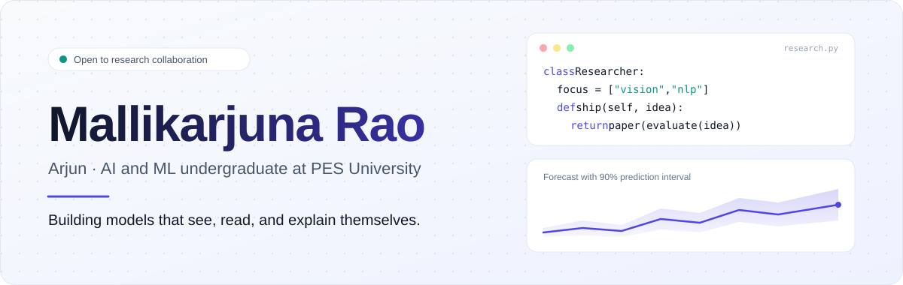
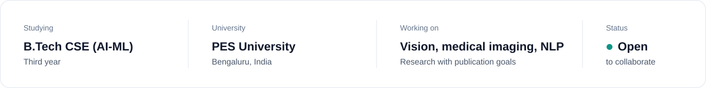
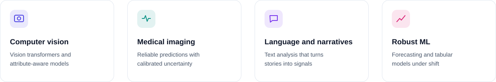

  

  

### About

  

 

I'm a third-year B.Tech student in Computer Science and Engineering (AI-ML) at PES University, Bengaluru. I work on machine learning projects across computer vision, medical imaging and NLP, usually in small teams over several months, and I care about getting work evaluated properly and written up for publication.

<b>Read as plain text</b>

 

| Field | Value |
| :--- | :--- |
| **Name** | Mallikarjuna Rao R V (Arjun) `@mallikarjunrao-sketch` |
| **Studying** | B.Tech CSE (AI-ML), PES University |
| **Location** | Bengaluru, India · UTC +05:30 |
| **Interests** | Computer vision, medical imaging, NLP, full-stack and secure systems |
| **Status** | Open to collaboration |

### What I work on

  

### Selected work

| Project | What it is | Stack |
| :--- | :--- | :--- |
| [**online-banking-system**](https://github.com/mallikarjunrao-sketch/online-banking-system) | Full-stack banking app with authentication, transactions and real-time balance tracking. | MERN, TypeScript |
| [**Secure-Music-Streaming-System**](https://github.com/mallikarjunrao-sketch/Secure-Music-Streaming-System) | Client-server audio streaming to multiple clients over encrypted SSL/TLS sockets. | Python, sockets |
| [**SAC-ViT**](https://github.com/mallikarjunrao-sketch/SAC-ViT) | Vision Transformer for fabric classification that checks predictions against physical attributes (roughness, shininess, weave, fibre visibility, colour) to flag confidently wrong answers. | PyTorch, ViT |

### Tools I use

   

   

      

### GitHub activity

  
  

### Connect with me

 

  

